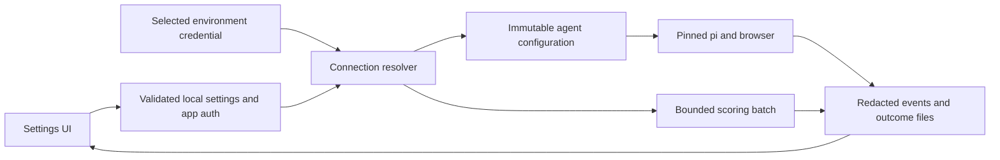

# Implementation contracts and foundation decisions

This document supplements the tickets after completeness review. It specifies intended behavior, not implemented APIs. Existing `ui/shared/types.ts` remains authoritative for unchanged payloads. T04 adds new config DTOs there (or a re-exported `ui/shared/config.ts`) rather than duplicating every existing contract. T02 is an explicit compatibility spike: it must resolve and record exact public dependency versions before dependent implementation starts; inventing untested version pins in a plan would not close that gate.

## Files, roots and launch behavior

New Node entrypoint: `scripts/pi-jobs.mjs`; commands: `setup`, `build`, `start`, `dev`, `demo`, `doctor`, `restore`. Root npm workspaces include `ui`; root `package-lock.json` is authoritative after T09 migration. Remove UI's obsolete lock only in that coordinated ticket. Root scripts expose `npm run setup`, `npm run build`, `npm start`, `npm run dev`, `npm run demo`, `npm run doctor` and `npm run restore`.

Fresh user path:

```sh
npm ci
npm run setup
npm run build
npm start
```

`setup` scaffolds private data and checks prerequisites; browser installation is an explicit reported step if absent. `start` also initializes missing templates idempotently, so omission of setup is recoverable, then serves the built UI at `http://127.0.0.1:4747`. Missing build exits with “Run npm run build”; missing model/profile/browser allows the UI to start and shows setup blockers. It never automatically starts an agent, buys a CAPTCHA solve or imports global keys. `doctor` uses exit 0 for apply-ready, 1 for required blockers, 2 for malformed invocation/internal failure; output distinguishes browse-ready from apply-ready. `demo` uses synthetic data and fake execution, builds if needed and never touches the selected live workspace.

`demo` rejects `--root`, ignores `PI_JOBS_ROOT`, creates a new `fs.mkdtemp` directory under the OS temp directory, and seeds only repository-reviewed synthetic fixtures. It injects that root into the UI and fake run manager; real pi/provider/solver execution is disabled server-side in this mode. Cleanup closes the fake manager/watchers then removes only that exact temporary directory on exit. A crash may leave a synthetic directory; cleanup never guesses a live root. Test with a live-workspace sentinel and hostile root override that the sentinel and live credentials remain untouched. A real extension integration test is a separate complete temporary clone with local fake providers/ATS, not demo mode.

Root resolution: `--root` > existing `PI_JOBS_ROOT` > code checkout root derived from launcher location. Resolve to a canonical real path and reject a different code root for actual execution in v1. An explicit root is valid for a complete independent clone, not an arbitrary folder of data. The launcher loaded from that clone uses its own extensions. UI-only test constructors may inject a fixture root; real starts require extension-root/cwd equality.

Define shared resolver exports in a module importable by both extension and server builds:

```ts
resolveWorkspaceRoot(options: { explicitRoot?: string; envRoot?: string; codeRoot: string }): string
resolvePiAgentDir(root: string): string // join(root, '.pi-jobs', 'pi-agent')
resolveBrowserProfileDir(root: string): string // join(root, '.browser-data')
```

Paths beginning `/.pi-jobs/` elsewhere in the plan mean repository-root-relative ignore patterns, never the OS root. Keep `.browser-data` location to preserve existing login sessions; do not move it incidentally. Pi child cwd is the canonical root; `PI_CODING_AGENT_DIR` is set programmatically to the resolved app directory. Server serves `ui/dist` derived from its package location. `--port` overrides 4747; bind is always 127.0.0.1. Development frontend is 127.0.0.1:5173 with strict port and explicit API target. Occupied port fails with the selected port and a retry command, rather than silently picking another.

SIGINT/SIGTERM uses existing run-manager disposal semantics with a bounded 10-second outer shutdown deadline before force termination of owned children. Do not kill a recorded PID without the existing ownership check. T02 documents the tested tree-kill behavior per OS.

## Version and platform gate

T02 creates `docs/runtime-matrix.md` recording exact Node patch, npm, pi, `@playwright/mcp`, browser revision/channel and package integrity as tested. Candidate pi is 0.84.3. Candidate Node family is 24 LTS, contingent on all package engines; do not add incompatible type/runtime assumptions. The initial verification targets are GitHub Actions `ubuntu-24.04` and `macos-15` with the chosen Node patch; interactive browser smoke must also record actual local OS/architecture. T20 pins CI action SHAs and records actual runner/image versions. Windows/WSL is “not yet verified” until the same matrix passes there. Release cannot close with “latest” in the required runtime manifest. T02 owns selecting a verified MCP/browser pair rather than claiming an arbitrary pair works.

The four extension entrypoints to prove are `.pi/extensions/job-applier.ts` (apply/status/acknowledgement and application tools), `.pi/extensions/job-gatherer.ts` (gather/score/review), `.pi/extensions/job-accounts.ts` (ATS credential tools), and `.pi/extensions/ats-adapters.ts` (Greenhouse schema/fill/submit/OTP tools, also verify disabled mode). Load these exact modules from the fixture clone and assert representative registered commands/tools without invoking live submission.

## Configuration types and credentials

```ts
type ProviderKind = 'openai' | 'anthropic' | 'google' | 'openai-compatible';
type CredentialSource = 'environment' | 'app-store' | 'none';
interface Connection {
  id: string; // server-generated UUID, immutable
  label: string; // 1..80 chars
  provider: ProviderKind;
  baseUrl?: string; // required for compatible, canonicalized URL
  api?: 'openai-completions' | 'openai-responses'; // compatible only
  envKeyName?: string; // explicit secret env name, never an expression
}
interface ModelSelection {
  connectionId: string;
  modelId: string; // nonempty exact catalog/manual ID
  thinking?: string; // allowlist from pinned pi + selected model capabilities
}
interface SettingsV2 {
  schemaVersion: 2;
  connections: Connection[];
  agent: ModelSelection | null;
  scoring: ModelSelection | null; // null inherits agent visibly
  captcha: LegacyCaptchaSettings; // preserve actual existing private storage schema
}
interface ConnectionView extends Connection {
  credential: { configured: boolean; source: CredentialSource };
  validation: { status: 'untested' | 'valid' | 'invalid'; checkedAt: string | null; code?: string };
}
interface RunConfigSnapshot {
  connectionId: string; provider: ProviderKind; modelId: string;
  baseUrl?: string; thinking?: string; credentialSource: CredentialSource;
  capturedAt: string; settingsRevision: string;
}
```

`LegacyCaptchaSettings` denotes the existing private on-disk type, not a new duplicated definition. Public settings serializer substitutes sanitized CAPTCHA status for that field. Never return `SettingsV2` storage objects directly. Test success expires logically when configuration/credential changes; it is not a guarantee of future quota.

Revision is SHA-256 of current file bytes, computed under the write lock; API responses wrap `{data,revision}`. Writes include `expectedRevision` and fail 409 `REVISION_CONFLICT` if it differs. Do not persist both a numeric revision and a hash. Multi-file config/auth changes use a journal with backup and recovery; do not expose a connection as configured before its key is durably saved.

The persisted `SettingsV2` deliberately has no `revision` property. Revision exists only in the API envelope and active-run snapshot; T04's revision-bearing contract refers to that envelope.

Built-in mapping: openai → pi `openai`, anthropic → `anthropic`, google → `google`. Distinct connection IDs map to isolated registered provider aliases in the pi adapter so same-type connections cannot overwrite one another. Compatible connections use the chosen supported pi API protocol and explicit base URL. T02 proves aliasing preserves native capabilities; if not, that spike must select a supported isolated mapping before T05.

Default existing env names: `OPENAI_API_KEY`, `ANTHROPIC_API_KEY`, `GEMINI_API_KEY`; compatible uses explicitly supplied `envKeyName` or stored/no key. Env names match `^[A-Z][A-Z0-9_]*$`, with no `!command`, interpolation or shell evaluation. Multiple same-provider connections sharing a default env key show that fact; an explicit per-connection name disambiguates. These are optional existing provider conventions, not new mandatory deployment secrets.

Resolution: selected connection's explicit/default nonempty environment key → app-owned stored key → keyless local compatible endpoint if supported → `CREDENTIAL_MISSING`. Do not fall through to global pi auth. Store via pi adapter at `<root>/.pi-jobs/pi-agent/auth.json`, mode 0600, containing only app-owned aliases; metadata/custom models at that directory's `models.json`. Never pass keys with `--api-key`. Resolve credentials privately alongside a sanitized snapshot. Before every real run, materialize a private `<root>/.pi-jobs/runs/<runId>/pi-agent/` (0700 directory; auth/model files 0600) containing only selected connections and resolved literal credentials/configuration. Point child `PI_CODING_AGENT_DIR` at that per-run directory, overriding the base launcher directory. Scrub unrelated provider auth/environment inheritance; scoring gets a private in-memory snapshot for its batch. UI edits affect the next run. On termination delete per-run auth/model credential files; startup removes stale owned snapshots after checking no live owner. Never claim guaranteed physical secure erasure. Preserve only explicitly sanitized run history. T06 blocks a fake run, replaces the stored key, resumes it and asserts later provider requests still use the original fixture key; a newly started run must use the replacement.

New errors: `CONFIG_INVALID`, `CONNECTION_MISSING`, `CREDENTIAL_MISSING`, `MODEL_UNAVAILABLE`, `TOOLS_UNSUPPORTED`, `AUTH_REJECTED`, `QUOTA_EXCEEDED`, `UPSTREAM_TIMEOUT`, `UPSTREAM_UNAVAILABLE`, `REVISION_CONFLICT`, `RUN_BUSY`. HTTP mapping is in plan.md. Preserve provider-native reasoning options through the validated catalog; do not adopt the reviewer's illustrative fixed enum that could remove existing supported levels.

## Local API boundary

T08 implements `ui/server/localAccess.ts`. Allow Host `127.0.0.1:<selected-port>` and explicitly configured local development proxy host `127.0.0.1:5173`; no arbitrary wildcard Host. Validate Origin against the corresponding exact origin. Reject foreign `Sec-Fetch-Site` values; API reads with no Origin remain usable by local CLI only under valid Host/fetch metadata rules.

`GET /api/session` supplies a cryptographically random per-process CSRF token after host/origin checks, `Cache-Control: no-store`, no CORS. Browser keeps it in memory and sends `X-Pi-Jobs-CSRF` on every mutation, connection test and credential reveal. CLI obtains the same token from loopback then supplies the header. GET/SSE use same-origin browser restrictions and strict host/origin checks; foreign reads and preflights are rejected. Restart invalidates token; client refetches on token-expired 403 without automatically replaying non-idempotent application starts. This protects browser-origin attacks, not malicious processes already running as the OS user.

Custom provider destinations are explicitly user-configured. Allow loopback HTTP/HTTPS, remote HTTPS, and private LAN HTTPS for self-hosted providers; local networking is an intended capability. Reject URL userinfo, fragments, non-HTTP protocols and redirects to another authority; do not accept per-request arbitrary fetch URLs or read model endpoints from job descriptions. This is not a general internet proxy. Show destination when configuring/testing a connection. Add timeout/body caps and do not forward credentials across redirects.

## Scoring and run compatibility

Scoring request extension: `POST /api/runs {kind:'score',slugs?:string[]}`. Omitted list chooses up to 50 unscored, non-dismissed discoveries in stable slug order; explicit list accepts 1–50 safe slugs. No arbitrary prompt or shell command in this route. Initial concurrency 2, per-request timeout 60 seconds, maximum 2 retries only for 429/transient 5xx/network errors with 1s then 3s backoff and bounded Retry-After (30s). Abort cancels pending requests and stops scheduling. Persist completed job scores individually; do not overwrite a score written after batch snapshot without conflict handling.

Prompt is a fixed versioned template in the scoring adapter: compare supplied candidate summary/preferences to the untrusted posting, treat posting text as data, return JSON `{score: integer 1..5, reason: string 1..1000 chars}` only. Candidate summary capped at 8,000 characters; job description 20,000; reject absent description rather than hallucinating a score. No tools for scoring. Persist existing `llm_score`, `llm_reasoning`, `llm_scored_at` (UTC ISO-8601) plus optional model/template provenance. Failed parse produces per-job error and leaves existing file unchanged. Do not require model-generated timestamps. Fixtures verify truncation, bad JSON, conflicting edits, mixed batch outcomes and cancellation.

Preserve current `RunStatus`: `starting | running | waiting | done | stopped | failed`. `done` requires clean exit after Finish; `stopped` follows Abort; unsolicited exit is failed. Existing `waiting` means a settled live agent, not necessarily a user question. UI waiting-for-input derives from unresolved `ui_request`; reconnecting is connection state; interrupted is a presentation reason on failed run, not an unreviewed new persistent enum. Preserve `RunEvent` and reply/UI-response bodies from `ui/shared/types.ts`. Add score kind and sanitized config snapshot through typed additive changes.

Existing application states remain `queued | in_progress | paused_for_user | submitted | aborted | blocked | failed`. Hiring stages remain `submitted | interviewing | offer | rejected | withdrawn | no_response`. Only the applier outcome persistence path marks submitted and moves queue → applied after observed confirmation under existing adapter rules. UI run completion never does this. Existing estimated file-only records remain estimated. T07/T16 add tests for “process done, submission unknown” and “confirmed submitted, process later failed.” Queue order remains `listQueue`'s ordering matched to applier; do not replace it with visual sort order.



## Migration, export and final decisions

T03 uses `<root>/.pi-jobs/workspace-version.json` with `{version:2,lastMigration:'settings-v2'}` and backups `<root>/.pi-jobs/backups/<UTC timestamp>-settings-v2/manifest.json`. Manifest maps relative files to original hashes and backup filenames. Atomic update: write same-directory temporary file, flush/close, rename while holding lock; journal multi-file migrations and restore incomplete transaction before startup. `npm run restore -- --backup <id>` refuses while a run is active, verifies hashes/containment, snapshots current files first, then restores originals. Legacy external code cannot be forced to understand the marker; downgrade requires restoring the backup before using legacy code, stated explicitly in docs.

T01 creates `scripts/release-manifest.json` with schema version, reviewed include paths and explicit exclusions. Starting inclusions: package/config/build files, `.pi/extensions/**`, sanitized `.mcp.json`, `templates/**`, `ui` source/tests/public assets excluding runtime output, approved `scripts` files, public docs/license, and **only this plan directory** under `Codex-info/plans`. Exclude old `claude-info` plans, personal workspace files, browser/auth/session data, root ad hoc apply/test scripts, resumes/screenshots and private Git metadata. Every included script/fixture is individually reviewed; directory names alone are not proof of safety. Public screenshots are generated from synthetic fixtures into `docs/images/`, then scanned.

Proposed commands: `npm run release:audit -- --candidate <path>` and `npm run release:export -- --output <path>`. Output must be an empty directory outside the live checkout and have no overlapping realpath. Audit exit 0 clean, 1 prohibited/unreviewed files, 2 execution error. T22 records included file hashes, source baseline, candidate commit, matrix results and scan results in `release-report.md` alongside the candidate, excluding machine paths/private findings from public artifacts. Scan every reachable export ref and candidate archive. No history is copied from source.

Owner decision gate: **license and GitHub destination must be selected before T21/T22 close**. Recommendation remains MIT; no implied consent to license selection or publication. Other tickets can complete independently. Final candidate is not called publish-ready until these decisions and all checks are satisfied.
